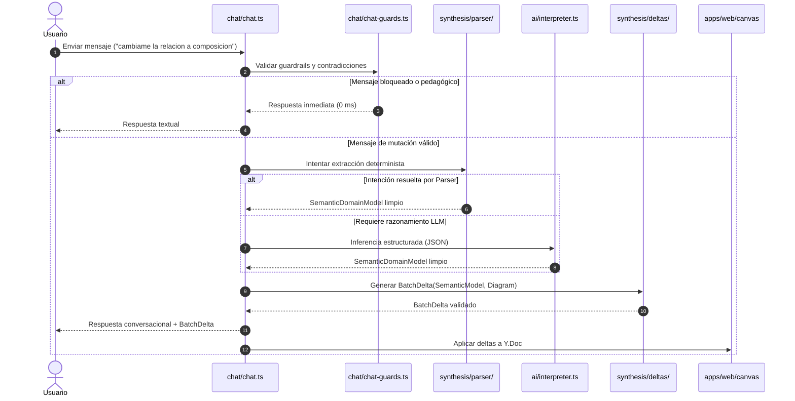

# Diseño: Arquitectura Limpia y Desacoplamiento Modular

## Decisiones de Arquitectura

### 1. Adopción de Screaming Architecture en `apps/api`
* **Razón**: La raíz plana de `apps/api/src` mezclaba adaptadores de I/O, controladores HTTP, motores de grafos y lógica de IA.
* **Decisión**: Los archivos DEBEN agruparse en subdirectorios temáticos que reflejen el dominio funcional del sistema:
  - `synthesis/`: Creación y mutación de modelos UML a partir de IA y texto.
  - `chat/`: Gestión conversacional, streaming y guardrails.
  - `diagram/`: Auditoría formal OOAD y consultas sobre el lienzo.
  - `io/`: Importación y exportación de formatos (XMI, imágenes).
  - `ai/`: Adaptadores e intérpretes hacia los LLMs.

### 2. Desacoplamiento del Motor de Deltas y Heurísticas de Lenguaje
* **Razón**: `domain-synthesizer.ts` mezclaba en un solo archivo de 4.300 líneas la interpretación de texto informal y la generación matemática de deltas para el lienzo.
* **Decisión**:
  - `delta-generator.ts` y sus submódulos (`deltas/`) SHALL ser puramente deterministas: reciben un `SemanticDomainModel` y retornan `BatchDelta`. No DEBEN contener regexes de lenguaje natural ni lógica de inferencia.
  - `text-intent-parser.ts` y sus submódulos (`parser/`) SHALL encargarse exclusivamente de la sanitización, normalización ortográfica y extracción de intenciones desde prosa sucia.

### 3. Diagrama de Secuencia: Flujo Desacoplado de Mutación UML

### 4. Descomposición del Frontend bajo el Patrón Custom Hooks
* **Razón**: `DiagramCanvas.tsx` acumulaba 2.919 líneas gestionando eventos de ventana, atajos, DnD y renderizado React Flow.
* **Decisión**:
  - `DiagramCanvas.tsx` DEBE actuar como un componente contenedor/layout de menos de 400 líneas.
  - La lógica de atajos de teclado SHALL residir en `useCanvasShortcuts`.
  - El drag and drop de herramientas SHALL residir en `usePaletteDnD`.
  - El cálculo geométrico de conectores SHALL residir en `useQuickLinker`.
  - La presencia multiusuario SHALL residir en `useCollabCursors`.
