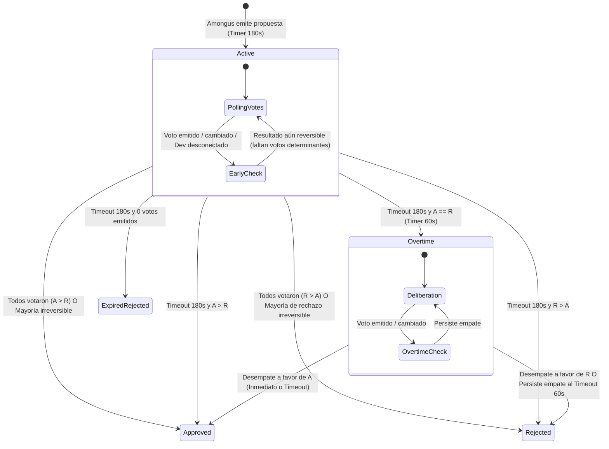

# Diseño de Arquitectura: Sistema Inteligente de Votación y Quórum

## Decisiones de Arquitectura (ADR)

### ADR-01: Estado de Votación Distribuido mediante Yjs CRDT
* **Contexto**: Las propuestas y votos deben sincronizarse de inmediato entre todos los navegadores conectados sin latencia de polling ni desincronización de temporizadores.
* **Decisión**: Almacenar el estado de cada votación en un mapa compartido de Yjs (`ydoc.getMap('proposal-votes')`), indexado por `proposalId` o `deltaId`.
* **Estructura del Estado**:
  ```typescript
  interface ProposalVoteState {
    proposalId: string;
    createdAt: number; // timestamp epoch ms
    expiresAt: number; // timestamp epoch ms (inicialmente createdAt + 180_000)
    isOvertime: boolean;
    status: 'active' | 'overtime' | 'approved' | 'rejected' | 'expired_rejected';
    votes: Record<string, 'approve' | 'reject'>; // userId/clientId -> decision
  }
  ```
* **Consecuencias**:
  - Toda emisión o cambio de voto viaja por WebSockets en < 50 ms.
  - La sincronización temporal toma como referencia el timestamp del servidor o del inicio compartido, evitando discrepancias de reloj local.

### ADR-02: Algoritmo de Evaluación por Mayoría Irreversible (`evaluateResolution`)
* **Contexto**: Se requiere evitar esperas innecesarias de 3 minutos cuando una opción ya alcanzó una mayoría matemática inalcanzable, independientemente de cuántos miembros falten por votar.
* **Fórmula Matemática General**:
  Dados:
  - $N$: Número de humanos conectados según `awareness` ($N \ge 1$).
  - $A$: Votos acumulados a favor ("Aprobar").
  - $R$: Votos acumulados en contra ("Rechazar").
  - $P = N - (A + R)$: Votos pendientes de emitir.
  - $M = \lfloor N / 2 \rfloor + 1$: Mayoría absoluta requerida para ganar sin depender del resto.

  **Regla de Resolución Anticipada**:
  1. **Victoria por Mayoría Absoluta**: Si $A \ge M$, se aprueba de inmediato (incluso si faltan $P$ votos, ya es matemáticamente imposible que $R$ alcance o empate a $A$).
  2. **Rechazo por Mayoría Absoluta**: Si $R \ge M$, se rechaza de inmediato.
  3. **Votación Completa ($P == 0$)**: Si todos votaron, se resuelve por mayoría simple ($A > R \rightarrow$ Aprobada; $R > A \rightarrow$ Rechazada; $A == R \rightarrow$ Overtime).
  4. **Resultado Reversible**: Si $A < M$ y $R < M$, y aún existe la posibilidad de que los $P$ votos pendientes empaten o alteren el líder ($|A - R| \le P$), la votación **continúa abierta**.

---

## Máquina de Estados de la Votación



---

## Lógica de Quórum Reactivo ante Desconexiones
1. Cada cliente escucha los cambios de presencia mediante `provider.awareness.on('change', ...)`.
2. Al desconectarse un usuario:
   - Se elimina su clave del mapa de votos si no se desea computar votos desconectados, o se conserva su voto pero se reduce $N$.
   - Se vuelve a ejecutar `evaluateProposalStatus(proposalId)`.
   - Si al reducirse $N$ a 1 (queda solo un desarrollador), el quórum pasa a $1/1$ y su decisión personal define la propuesta al instante.

