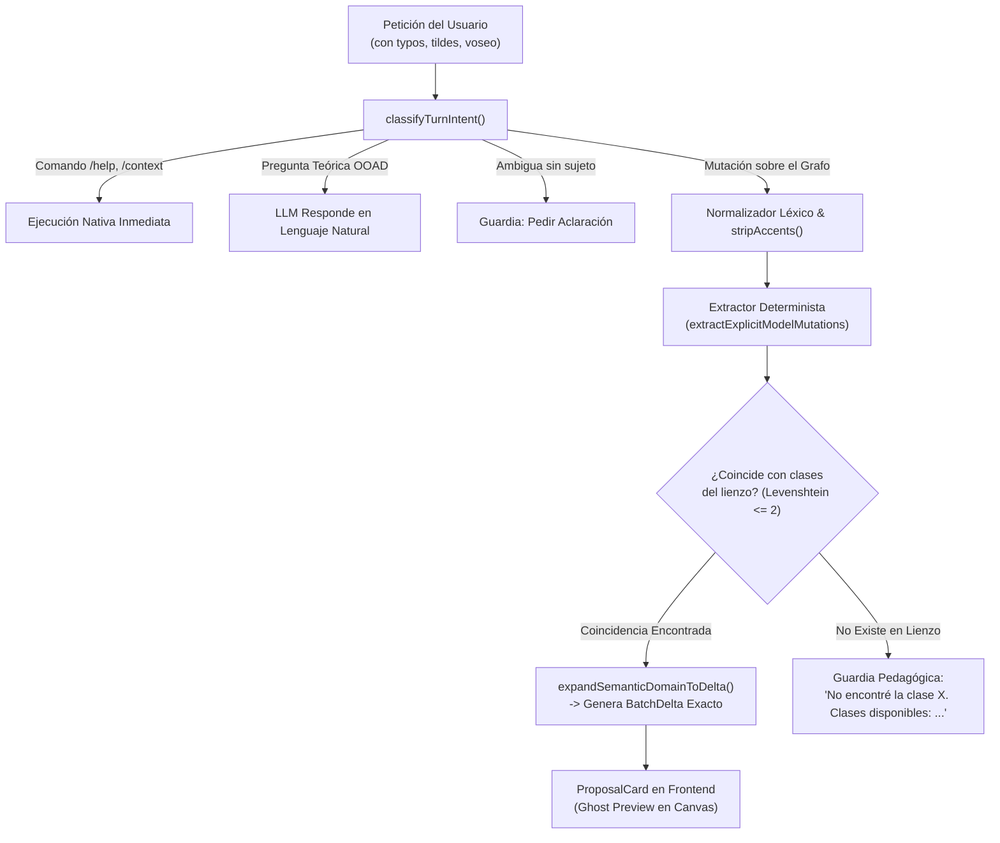

# Diseño Técnico: NLP Canonicalizer y Resiliencia Determinista

## Arquitectura

## Componentes y Cambios

### 1. `stripAccents` y Tolerancia a Fallos Léxicos
En `packages/adapters-ai/src/normalizer.ts`:
- Normalización Unicode NFD para eliminar marcas diacríticas (`préstamo` -> `prestamo`).
- Comparación insensible a mayúsculas y acentos.
- Función de coincidencia fuzzy usando `levenshtein(a, b) <= 2` contra el array de clases del diagrama actual.

### 2. Extractor de Atributos Determinista
En `apps/api/src/domain-synthesizer.ts`:
- Detección de patrones:
  - `a la clase <Clase> (agrega|agregarle|pone|ponele|sumale) [el atributo|un] <nombre> [de tipo <tipo>]`
  - `(agrega|agregar|add) [el atributo] <nombre> [de tipo <tipo>] a (la clase )?<Clase>`
- Mapeo de tipos:
  - `entero` / `int` / `integer` -> `int`
  - `texto` / `cadena` / `string` -> `string`
  - `booleano` / `bool` -> `boolean`
  - `fecha` / `date` -> `date`
  - `decimal` / `float` / `double` -> `float`
- Generación de `updates.attributes` sobre la clase resuelta.

### 3. Aislamiento de Canales en `apps/api/src/index.ts`
- Modificar la consulta de `listChatMessages` para el turn history:
  - Si el canal es `direct_bot`: recuperar exclusivamente turnos de `direct_bot` con el bot.
  - Si el canal es `group`: recuperar exclusivamente mensajes dirigidos al bot (`@Amongus` o respuestas previas del bot), ignorando el tráfico entre usuarios.

### 4. Sanitización del Prompt Few-Shot en `synthesizeDomainModel`
- Sustituir los nombres `orderNumber` y `totalAmount` por placeholders genéricos protegidos contra fugas.

