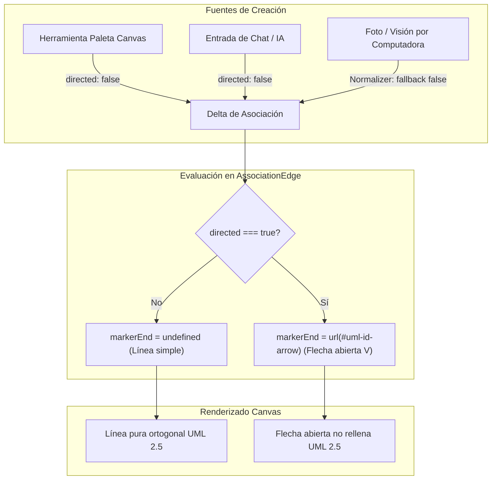

# Diseño Arquitectónico: Sanitización de Notación Estricta UML 2.5

## Decisiones de Arquitectura (ADR)

### ADR-01: Vértices Rectangulares a 90° (`border-radius: 0`)
* **Contexto**: El CSS original de `.uml-class` utilizaba `border-radius: 4px` por influencia de librerías de diseño web contemporáneas (Tailwind, Material Design).
* **Decisión**: Eliminar el radio de curvatura en los nodos `.uml-class` estableciendo `border-radius: 0;` en [`apps/web/src/canvas/canvas.css`](file:///d:/Moondancer/software1/parcial1/apps/web/src/canvas/canvas.css).
* **Consecuencias**: El renderizado emula con exactitud las herramientas CASE formales (Enterprise Architect, Visual Paradigm, Rational Rose) cumpliendo el estándar ISO/IEC 19505-1 (OMG UML 2.5.1).

### ADR-02: Geometría de Marcador SVG para Asociación Dirigida
* **Contexto**: [`apps/web/src/canvas/edges/AssociationEdge.tsx`](file:///d:/Moondancer/software1/parcial1/apps/web/src/canvas/edges/AssociationEdge.tsx) utilizaba un triángulo sólido:
  ```xml
  <path d="M 0 0 L 12 6 L 0 12 Z" fill="#1a1a2e" />
  ```
  Esto violaba la convención UML donde un triángulo sólido o hueco cerrado se reserva para tipos específicos de señal o generalización, mientras que la navegabilidad de una asociación es una flecha abierta de dos trazos ("open stick arrowhead").
* **Decisión**: Reemplazar la geometría del marcador por:
  ```xml
  <path d="M 0 0 L 11 6 L 0 12" fill="none" stroke="#1a1a2e" strokeWidth="1.5" />
  ```
  manteniendo consistencia con la implementación ya validada en [`DependencyEdge.tsx`](file:///d:/Moondancer/software1/parcial1/apps/web/src/canvas/edges/DependencyEdge.tsx).

### ADR-03: Inferencia por Defecto de Asociaciones en Visión por Computadora
* **Contexto**: [`payload-normalizer.ts`](file:///d:/Moondancer/software1/parcial1/packages/adapters-ai/src/vision/payload-normalizer.ts) aplicaba `directed: true` como valor por defecto cuando el LLM omitía el campo en una asociación extraída.
* **Decisión**: Cambiar la cláusula de normalización a:
  ```typescript
  directed: typeof d.directed === 'boolean' ? d.directed : false
  ```
  y actualizar el schema de ejemplo en el prompt de extracción ([`prompts.ts`](file:///d:/Moondancer/software1/parcial1/packages/adapters-ai/src/vision/prompts.ts)) a `"directed": false`.
* **Consecuencias**: Las fotos de diagramas de clase con asociaciones estándar se mapean a líneas simples sin flechas adventicias.

---

## Diagrama de Flujo: Pipeline de Renderizado y Normalización de Asociaciones



